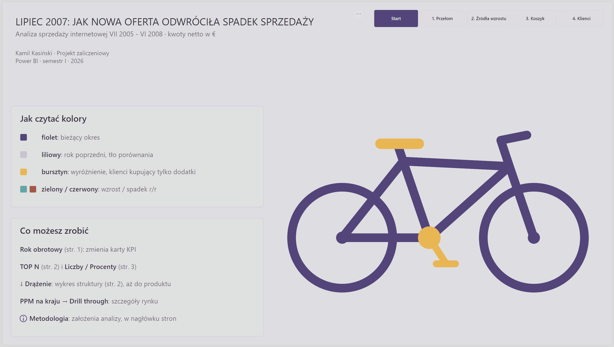

# Lipiec 2007: jak nowa oferta odwróciła spadek sprzedaży

**Raport Power BI** · analiza sprzedaży internetowej VII 2005 – VI 2008 · kwoty netto w €

Po roku spadku o ok. 19% firma wprowadziła w lipcu 2007 nową ofertę (rowery turystyczne oraz akcesoria i odzież), a przychód w kolejnym roku obrotowym wzrósł o 186%. Raport pokazuje, skąd wziął się wzrost i do kogo skierować kolejną kampanię.

📄 **Case study na stronie:** https://kamkas93.github.io/kamil-kasinski/projekt-lipiec-2007.html

<!--  -->

## W 30 sekund

- **Problem:** w roku obrotowym 2006/2007 przychód spadł o ok. **19%** r/r (7,1 → 5,8 mln €). Firma sprzedawała wtedy wyłącznie rowery.
- **Zwrot:** od **lipca 2007** w ofercie są nowa linia rowerów turystycznych oraz akcesoria i odzież. W 2007/2008 przychód wzrósł do **16,5 mln € (+186% r/r)**.
- **Źródło wzrostu:** rowery dały ok. **91% przyrostu** (ok. 9,7 z 10,7 mln €): górskie +4,2 mln €, nowa linia turystyczna +3,8 mln €, szosowe +1,7 mln €. **USA (+282%)** wyprzedziło Australię (+109%).
- **Mechanizm:** r/r klientów przybyło ok. **5,4×** (3 222 → 17 412), a przychód na klienta spadł ok. **1,9×** (1 788 € → 946 €). Względem 2005/2006: klientów prawie 8× więcej (2 206 → 17 412), przychód na klienta ok. 3× mniejszy (3 206 € → 946 €).
- **Koszyk (2007/2008):** **89%** rowerzystów dokupuje dodatki, ale **połowa klientów (8 786 osób)** kupuje wyłącznie dodatki.
- **Rekomendacja:** kampania rowerowa do klientów kupujących tylko dodatki, najpierw w **USA (prawie 4 tys. osób)**, z akcentem na grupy 28–34, 55+ i duże rodziny.

<!--  -->

## Co jest w środku

| Strona | Tytuł-wniosek | Zawartość |
|---|---|---|
| Start | Lipiec 2007: jak nowa oferta odwróciła spadek sprzedaży | panele „Jak czytać kolory” i „Co możesz zrobić”, rower SVG jako przycisk wejścia |
| 1. Przełom | Lipiec 2007: nowa oferta odwróciła spadek sprzedaży | 4 karty KPI z r/r, slicer roku obrotowego, trend z wyróżnionym VII 2007, AC vs PY (IBCS), klienci vs przychód na klienta |
| 2. Źródła wzrostu | Wzrost napędziły rowery i rynek USA | kraje AC vs PY, ranking TOP N podkategorii (3/5/8/10), drill-down Kategoria → Podkategoria → Produkt |
| 3. Koszyk | Połowa klientów kupuje tylko dodatki | karty 89% / 50% / 949 / 8 786, segmenty z przełącznikiem Liczby / Procenty (bookmarki), rekomendacja |
| 4. Klienci | Bez roweru zostają najmłodsi, najstarsi i duże rodziny | segmenty wg wieku, liczby dzieci, stanu cywilnego; piktogram płci; persona |
| Szczegóły kraju | „Szczegóły: [kraj]” (drill-through) | KPI, pozycja wśród 6 rynków, segmenty, trend, ranking, rekomendacja; wszystko z dynamicznymi tytułami |
| Nota metodologiczna | – | założenia analizy |

**Funkcjonalności:** CALCULATE · Time Intelligence (`SAMEPERIODLASTYEAR`) · 39 miar · drill-down · drill-through · bookmarki · parametr TOP N · niestandardowe etykiety · dynamiczne tytuły i kolory (miary `A` i `C`) · grafiki SVG z DAX · nawigacja i przyciski · IBCS · dopracowane tooltipy.

Strona po stronie: [docs/strony-raportu.md](docs/strony-raportu.md)

## Warsztat techniczny

**1. Rok obrotowy VII–VI w tabeli dat.** W latach kalendarzowych 2008 wyglądał na plateau (tylko 6 miesięcy). Rok obrotowy pokazał prawdziwą historię.

```dax
"RokObrotowy",
    VAR __Rok = YEAR([Date])
    VAR __RokStart = IF(MONTH([Date]) >= 7, __Rok, __Rok - 1)
    RETURN __RokStart & "/" & (__RokStart + 1)
```

**2. Cross-selling bez numeru zamówienia.** W danych nie ma numeru zamówienia, więc zamiast koszyków porównuję zbiory klientów.

```dax
# KlienciRoweryIDodatki =
    VAR __KlienciRowery = CALCULATETABLE(VALUES(FactInternetSales[Klucz klienta]), DimKategoria[Nazwa Kategorii] = "Rowery")
    VAR __KlienciDodatki = CALCULATETABLE(VALUES(FactInternetSales[Klucz klienta]), DimKategoria[Nazwa Kategorii] <> "Rowery")
    RETURN COUNTROWS(INTERSECT(__KlienciDodatki, __KlienciRowery))
-- tylko dodatki: EXCEPT(__KlienciDodatki, __KlienciRowery)
```

**3. Ranking TOP N z parametrem.** `ALL` liczy ranking względem wszystkich podkategorii, a filtry roku i kraju zostają.

```dax
$ PrzyrostTopNPodkategorie =
    VAR __N = [ParametrTopN Value]
    RETURN
        CALCULATE(
            [$ PrzyrostPrzychodu],
            FILTER(DimPodkategoria, RANKX(ALL(DimPodkategoria), [$ PrzyrostPrzychodu]) <= __N)
        )
```

Pełny katalog miar: [dax/](dax/README.md) · model danych: [docs/model-danych.md](docs/model-danych.md)

## Decyzje i lekcje

- **Rok obrotowy zamiast kalendarzowego.** Wniosek sprawdziłem też na tych samych miesiącach (I–VI) w latach kalendarzowych.
- **Hipoteza sprawdzona na danych.** Pierwsza intuicja „wzrost dały dodatki” była niepełna: 91% wzrostu dały rowery, w tym nowa linia turystyczna.
- **Części muszą sumować się do całości.** Brak filtra roku zawyżał ranking (trzy podkategorie > cały przyrost firmy). Błąd wyłapałem dzięki liczbom kontrolnym.
- **Uczciwa wizualizacja.** Sylwetka wypełniana do połowy wysokości zakrywała ok. 75–80% powierzchni, więc zamieniłem ją na piktogram 10 sylwetek.
- **Świadomie odrzucone:** lift (≈ 0,94, nie różnicuje), `CROSSFILTER` (zbędny), `SUMX` dla zysku (ilość zawsze = 1), panel filtrów jako bookmark.

Więcej: [docs/decyzje.md](docs/decyzje.md) · [docs/metodologia.md](docs/metodologia.md) · [docs/design-system.md](docs/design-system.md)

## Jak otworzyć

1. Zainstaluj **Power BI Desktop** (Windows, bezpłatny).
2. Otwórz plik `.pbix`. Raport działa w trybie **Import**, więc dane są w pliku i połączenie z bazą nie jest potrzebne.
3. Motyw: [theme/Motyw_Rowery_Fiolet_v2.json](theme/Motyw_Rowery_Fiolet_v2.json) (*Widok → Motywy → Przeglądaj w poszukiwaniu motywów*).
4. Jak czytać raport: [docs/instrukcja-uzytkownika.md](docs/instrukcja-uzytkownika.md).

Raport online: [LINK DO RAPORTU — opcjonalnie]

Plik `.pbix` nie jest wersjonowany w repozytorium (patrz [report/](report/README.md)).

## Struktura repozytorium

```
├── README.md
├── dax/       katalog miar (7 folderów) + tabele i kolumny
├── docs/      metodologia, model danych, strony raportu, design system, decyzje, instrukcja
├── theme/     motyw JSON raportu
├── assets/    grafiki SVG użyte w raporcie
├── img/       zrzuty ekranu i GIF-y
└── report/    miejsce na plik .pbix
```

## Nota o danych, AI i autorze

- **Dane:** przykładowa baza Microsoft **AdventureWorks** (przetłumaczona wersja udostępniona w ramach kursu). Dane nie dotyczą prawdziwej firmy. Kwoty są pokazane w umownej walucie €.
- **Kontekst:** projekt zaliczeniowy I semestru studiów podyplomowych z analizy danych (Power BI, 2026).
- **AI:** projekt był konsultowany z asystentem AI. Model danych, miary i decyzje analityczne wykonałem sam: AI zadawał pytania i robił code review. Gotowe propozycje AI dotyczyły m.in. motywu JSON, miar SVG i części tytułów dynamicznych.
- **Autor:** Kamil Kasiński · [strona](https://kamkas93.github.io/kamil-kasinski/) · [LinkedIn](https://www.linkedin.com/in/kamil-kasinski-8a7204185) · [GitHub](https://github.com/kamkas93)

Nota o danych i prawach: [NOTICE.md](NOTICE.md)

---

## English summary

**July 2007: how a new product range reversed a sales decline.** A Power BI report on online sales of a bike shop (sample Microsoft AdventureWorks data, fiscal years July–June, 2005/2006 – 2007/2008, net amounts in a nominal €).

- In 2006/2007 revenue fell by about 19% (€7.1M → €5.8M). From July 2007 the company added touring bikes, accessories and clothing. In 2007/2008 revenue grew to €16.5M (+186%).
- Bikes still generated about 91% of the growth. The USA (+282%) overtook Australia (+109%).
- Year over year, the number of customers grew about 5.4× (3,222 → 17,412), while revenue per customer fell about 1.9× (€1,788 → €946).
- 89% of bike buyers also buy accessories, but half of all customers (8,786) buy only accessories. Recommendation: a bike campaign for these customers, starting in the USA (almost 4,000 people).

Technical highlights: fiscal-year date table, customer-set basket analysis with `INTERSECT` / `EXCEPT` (no order number in the data), Top N ranking with a parameter, dynamic titles, SVG measures, IBCS design, bookmarks, drill-down and drill-through. The project was built as part of postgraduate studies; an AI assistant was used for questions and code review, while the model, measures and decisions are my own.
