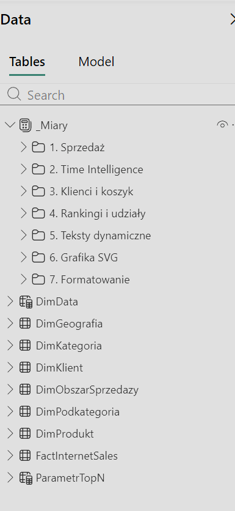

# Katalog DAX

Wszystkie miary są w tabeli `_Miary`, w 7 folderach. W modelu jest **39 miar** oraz miara parametru `[ParametrTopN Value]`.

**Konwencja nazw** (wymóg uczelni):
- prefiksy: `$` waluta, `#` liczby, `%` procenty, `A` miary tekstowe, `C` miary koloru,
- PascalCase bez polskich znaków,
- zmienne `VAR __Nazwa`,
- miary bez nazwy tabeli, kolumny zawsze z tabelą,
- komentarze `--`.

| Plik | Zawartość |
|---|---|
| [kolumny_i_tabele.dax](kolumny_i_tabele.dax) | tabela dat `DimData`, kolumny obliczeniowe, parametr TOP N |
| [01_sprzedaz.dax](01_sprzedaz.dax) | przychód, koszt, zysk, marża |
| [02_time_intelligence.dax](02_time_intelligence.dax) | rok poprzedni i zmiany r/r |
| [03_klienci_i_koszyk.dax](03_klienci_i_koszyk.dax) | klienci i segmenty koszyka |
| [04_rankingi_i_udzialy.dax](04_rankingi_i_udzialy.dax) | ranking TOP N, pozycja i udział kraju |
| [05_teksty_dynamiczne.dax](05_teksty_dynamiczne.dax) | dynamiczne tytuły i rekomendacja |
| [06_grafika_svg.dax](06_grafika_svg.dax) | miary SVG (opis, kod do uzupełnienia) |
| [07_formatowanie.dax](07_formatowanie.dax) | miary koloru |

---

## Tabele i kolumny

| Obiekt | Opis |
|---|---|
| `DimData` | Własna tabela dat: pełne lata kalendarzowe obejmujące daty zamówień. Kolumna `RokObrotowy` (VII–VI, np. „2007/2008”) jest osią całej analizy. |
| `DimKategoria[GrupaProduktowa]` | „Rowery” albo „Dodatki” (akcesoria i odzież). |
| `DimKlient[Wiek]` | Pełne lata na 30.06.2008, czyli na koniec okna analizy. |
| `DimKlient[GrupaWiekowa]` / `[GrupaWiekowaSort]` | Przedziały 28–34, 35–44, 45–54, 55–64, 65+ i kolumna do sortowania. |
| `ParametrTopN[EtykietaTopN]` | Etykieta „TOP N” dla slicera (parametr numeryczny 1–10, slicer pokazuje 3/5/8/10). |

## 1. Sprzedaż

| Miara | Opis |
|---|---|
| `$ Przychod` | Suma `Wartość sprzedaży`, czyli kwota netto bez stałego podatku 8%. |
| `$ Koszt` | Suma kosztu. |
| `$ Zysk` | Przychód minus koszt. Bez `SUMX`, bo ilość zawsze = 1. |
| `% MarzaZysku` | Zysk / przychód. |
| `$ PrzychodNaKlienta` | Przychód / liczba klientów. Pokazuje mechanizm wzrostu: więcej klientów, mniejszy koszyk. |

## 2. Time Intelligence

| Miara | Opis |
|---|---|
| `$ PrzychodPY` | Przychód w analogicznym okresie roku wcześniej (`SAMEPERIODLASTYEAR`). |
| `% ZmianaPrzychodRR` | Zmiana przychodu r/r w %. |
| `$ ZyskPY` | Zysk rok wcześniej. |
| `% ZmianaZyskRR` | Zmiana zysku r/r w %. |
| `% MarzaZyskuPY` | Marża rok wcześniej. |
| `# ZmianaMarzyPP` | Zmiana marży w punktach procentowych (format `+0.0" p.p."`). |
| `# KlienciPY` | Liczba klientów rok wcześniej. |
| `% ZmianaKlienciRR` | Zmiana liczby klientów r/r w %. |
| `$ PrzyrostPrzychodu` | Przyrost przychodu r/r w €. Baza rankingu źródeł wzrostu. |

## 3. Klienci i koszyk

| Miara | Opis |
|---|---|
| `# Klienci` | Unikalni klienci liczeni w tabeli faktów, bo tam dociera filtr (bez `CROSSFILTER`). |
| `# KlienciRowery` | Klienci, którzy kupili rower. |
| `# KlienciDodatki` | Klienci, którzy kupili akcesoria lub odzież. |
| `# KlienciRoweryIDodatki` | Część wspólna obu zbiorów (`INTERSECT`). |
| `# KlienciDodatkiBezRoweru` | Kupujący dodatki, którzy nie kupili roweru (`EXCEPT`). Grupa docelowa rekomendacji. |
| `# KlienciRoweryBezDodatkow` | Kupujący rower bez dodatków (`EXCEPT`). |
| `% RowerzysciZDodatkami` | Odsetek rowerzystów, którzy dokupili dodatki (89% w 2007/2008). |
| `% KlienciTylkoDodatki` | Odsetek wszystkich klientów, którzy kupili tylko dodatki (50% w 2007/2008). |

## 4. Rankingi i udziały

| Miara | Opis |
|---|---|
| `$ PrzyrostTopNPodkategorie` | Przyrost r/r tylko dla N podkategorii o największym przyroście. `ALL` w `RANKX` liczy ranking względem wszystkich podkategorii, a filtry roku i kraju z innych tabel zostają. |
| `# PozycjaKraju` | Pozycja kraju wśród 6 rynków wg przychodu. |
| `% UdzialKraju` | Udział kraju w przychodzie wszystkich obszarów. |

## 5. Teksty dynamiczne

| Miara | Opis |
|---|---|
| `A PodtytulRanking` | Podtytuł rankingu z aktualną wartością N. |
| `A TytulRankingKraj` | Tytuł-wniosek: udział rowerów we wzroście i podkategoria z największym przyrostem. |
| `A TytulSzczegolyKraju` | „Szczegóły: [kraj]” na stronie drill-through. |
| `A TytulSegmentyKraj` | Liczba i odsetek klientów bez roweru w wybranym kraju. |
| `A TytulTrendKraj` | Przychód kraju w 2007/2008 i zmiana r/r. |
| `A RekomendacjaKraj` | Tekst rekomendacji dla wybranego kraju. |

## 6. Grafika SVG

| Miara | Opis |
|---|---|
| `A RowerWypelnienie` | Sylwetka roweru wypełniona bursztynem w proporcji `% KlienciTylkoDodatki` (`clipPath`, szerokość × 400 px). Reaguje na wybrany kraj. |
| `A IkonyPlec` | Piktogram 10 sylwetek (1 = 10%), kształt zależny od płci. `GENERATESERIES` + `CONCATENATEX` + `translate`. |

## 7. Formatowanie

| Miara | Opis |
|---|---|
| `C KolorZmianaPrzychodRR` | Kolor odchylenia r/r wg IBCS: zielony przy wzroście, czerwony przy spadku, pusty przy 0. |
| 3 analogiczne miary `C` | Ta sama logika dla zysku, klientów i marży. [DO UZUPEŁNIENIA: dokładne nazwy] |
| `C KolorTrendMiesiac` | Bursztyn dla VII 2007, fiolet po nim, liliowy przed. Wyróżnia punkt zwrotny na trendzie. |

---

Powyższy katalog opisuje 38 miar. [DO UZUPEŁNIENIA: nazwa, folder i opis 39. miary]
