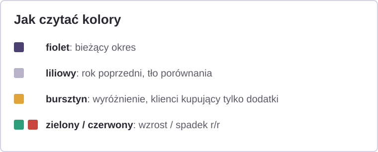
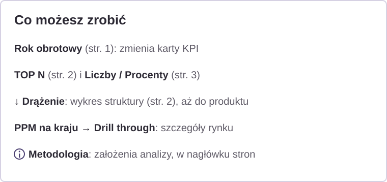

# Jak czytać raport

Krótka instrukcja dla osoby, która nie zna Power BI.

## O czym jest raport

Raport opowiada jedną historię: w roku obrotowym 2006/2007 sprzedaż internetowa spadła, a od **lipca 2007** nowa oferta (rowery turystyczne oraz akcesoria i odzież) odwróciła ten trend. Kolejne strony odpowiadają na pytania: **co się stało → skąd wzrost → co kupują klienci → do kogo kierować kampanię**.

- Wszystkie kwoty są **netto, w €** (waluta umowna).
- Rok obrotowy trwa **od lipca do czerwca**, np. „2007/2008” = VII 2007 – VI 2008.
- Tytuł każdej strony to **wniosek**, a nie nazwa wykresu. Wystarczy przeczytać tytuły, żeby poznać całą historię.

## Kolory

<!--  -->

| Kolor | Znaczenie |
|---|---|
| ciemny fiolet | bieżący okres |
| liliowy | rok poprzedni, tło porównania |
| bursztyn | wyróżnienie: lipiec 2007, klienci kupujący tylko dodatki |
| zielony / czerwony | wzrost / spadek r/r |

## Co możesz zrobić

<!--  -->

1. **Rok obrotowy** (strona 1): przyciski nad kartami zmieniają rok w kartach KPI. Pozostałe wykresy na stronie nie reagują na ten wybór.
2. **TOP N** (strona 2): wybierz 3, 5, 8 albo 10 podkategorii w rankingu przyrostu. Tytuł i podtytuł zmieniają się same.
3. **Drążenie** (strona 2): na wykresie struktury przejdź niżej: Kategoria → Podkategoria → Produkt.
4. **Liczby / Procenty** (strona 3): przełącz widok segmentów klientów.
5. **Szczegóły kraju:** kliknij kraj prawym przyciskiem myszy → *Drill through* → *Szczegóły kraju*. Wrócisz przyciskiem powrotu.
6. **ⓘ Metodologia** (nagłówek każdej strony): założenia analizy.

## Na co uważać

- „Klient kupił rower i dodatki” znaczy: ten sam klient kupił oba rodzaje produktów **w tym samym roku obrotowym**. W danych nie ma numeru zamówienia, więc nie wiadomo, czy był to jeden koszyk.
- Kraj = **obszar sprzedaży** transakcji, nie miejsce zamieszkania klienta.
- Lipiec 2008 jest pominięty, bo jest niekompletny (brak rowerów).
