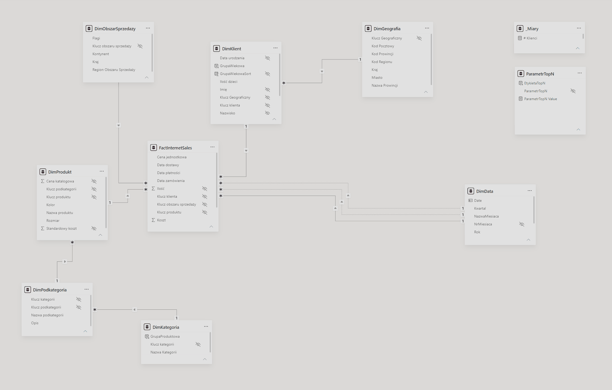
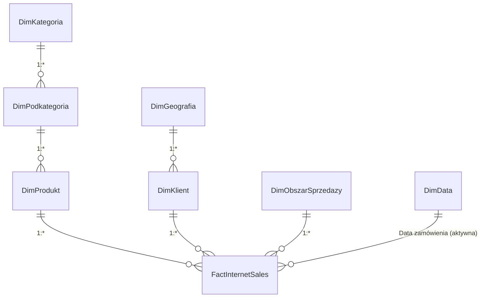

# Model danych

## Schemat

Model jest płatkiem śniegu (snowflake). Relacje są 1:* i jednokierunkowe.

`DimData[Date]` ma też relacje z datą płatności i datą dostawy. Obie są **nieaktywne**, aktywna jest tylko `Data zamówienia`.

## Tabele

| Tabela | Rola |
|---|---|
| `FactInternetSales` | Transakcje sprzedaży internetowej: wartość netto, koszt, klucze. |
| `DimKlient` | Klienci: wiek, płeć, stan cywilny, liczba dzieci. Dane osobowe ukryte. |
| `DimGeografia` | Miejsce zamieszkania klienta (do raportu nie wchodzi jako geografia sprzedaży). |
| `DimObszarSprzedazy` | Obszar sprzedaży przypisany do transakcji. **To jest geografia raportu.** |
| `DimProdukt` → `DimPodkategoria` → `DimKategoria` | Hierarchia produktu, używana w drill-down. |
| `DimData` | Własna tabela dat z rokiem obrotowym VII–VI. |
| `_Miary` | Tabela miar: 39 miar w 7 folderach. |
| `ParametrTopN` | Parametr numeryczny 1–10 dla rankingu TOP N. |

## Decyzje modelowe

- `DimData` jest oznaczona jako tabela dat, a Auto date/time jest wyłączone.
- Geografia = **obszar sprzedaży**, bo opisuje, gdzie zaliczono transakcję. Miejsce zamieszkania klienta to inna informacja.
- Klucze, dane osobowe (imię, nazwisko, data urodzenia) i kolumny techniczne są ukryte.
- Klientów liczę w tabeli faktów (`DISTINCTCOUNT(FactInternetSales[Klucz klienta])`), bo tam dociera filtr kategorii produktu. Dlatego nie potrzeba `CROSSFILTER`.
- W Power Query kody `Stan cywilny` (S/M) i `Płeć` (M/F) zamieniłem na polskie etykiety (Replace values).

## Foldery w `_Miary`

1. Sprzedaż · 2. Time Intelligence · 3. Klienci i koszyk · 4. Rankingi i udziały · 5. Teksty dynamiczne · 6. Grafika SVG · 7. Formatowanie

Szczegóły: [../dax/README.md](../dax/README.md).
