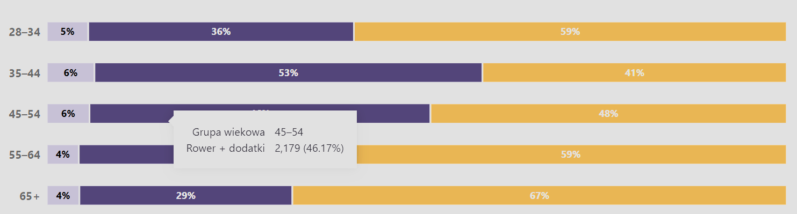

# Strony raportu

Każda strona ma tytuł-wniosek (IBCS). Nawigacja: Page navigator w nagłówku każdej strony, przycisk „ⓘ Metodologia” i przycisk powrotu na stronach ukrytych.

## Start

**Tytuł:** Lipiec 2007: jak nowa oferta odwróciła spadek sprzedaży
- autor,
- panel „Jak czytać kolory”,
- panel „Co możesz zrobić”,
- duży rower SVG jako przycisk wejścia do raportu.

## 1. Przełom

**Tytuł:** Lipiec 2007: nowa oferta odwróciła spadek sprzedaży
**Cel:** pokazać problem (spadek w 2006/2007) i zwrot (wzrost w 2007/2008).
- 4 karty KPI: przychód, zysk, marża, klienci, każda ze zmianą r/r w kolorze,
- Button slicer roku obrotowego, który steruje **tylko kartami**,
- trend miesięczny z wyróżnionym VII 2007 i adnotacją,
- AC vs PY wg roku obrotowego: nakładane słupki IBCS, etykieta Detail z % r/r,
- klienci vs przychód na klienta.

## 2. Źródła wzrostu

**Tytuł:** Wzrost napędziły rowery i rynek USA
**Cel:** pokazać, gdzie powstał przyrost (kraje, podkategorie).
- kraje AC vs PY,
- ranking TOP N podkategorii wg przyrostu: Button slicer TOP 3/5/8/10, dynamiczny tytuł i podtytuł,
- drill-down Kategoria → Podkategoria → Produkt,
- ikona ⓘ z instrukcją.

## 3. Koszyk

**Tytuł:** Połowa klientów kupuje tylko dodatki
**Cel:** pokazać cross-selling i grupę docelową rekomendacji.
- 4 karty: 89%, 50%, 949, 8 786,
- segmenty klientów z przełącznikiem **Liczby / Procenty** (bookmarki),
- kraje wg liczby klientów bez roweru,
- rekomendacja i rower SVG wypełniony w 50%.

## 4. Klienci

**Tytuł:** Bez roweru zostają najmłodsi, najstarsi i duże rodziny
**Cel:** opisać, do kogo kierować kampanię.
- 100% słupki segmentów wg grupy wiekowej, liczby dzieci i stanu cywilnego,
- piktogram płci,
- persona „Do kogo kierować kampanię rowerową”.

## Szczegóły kraju (ukryta, drill-through)

**Tytuł:** dynamiczny, „Szczegóły: [kraj]”
- KPI kraju, pozycja wśród 6 rynków, udział w przychodzie,
- segmenty, trend, ranking,
- rekomendacja i rower SVG (np. Kanada 63%).

Wszystkie tytuły na tej stronie są dynamiczne.

## Nota metodologiczna (ukryta)

Założenia: netto / 8% / € umowne, okno VII 2005–VI 2008, rok obrotowy, segmenty w 2007/2008, wiek na 30.06.2008, brak numeru zamówienia, obszar sprzedaży. Pełny opis: [metodologia.md](metodologia.md).

## Mapa wymagań zaliczenia

| Wymaganie | Gdzie |
|---|---|
| CALCULATE | większość miar |
| Time Intelligence | `SAMEPERIODLASTYEAR` (folder 2) |
| 39 miar | `_Miary` |
| Drill-down | str. 2, Kategoria → Podkategoria → Produkt |
| Drill-through | Szczegóły kraju |
| Bookmarki | str. 3, Liczby / Procenty |
| Parametr | TOP N (str. 2) |
| Niestandardowe etykiety | etykieta Detail z % r/r (str. 1) |
| Dynamiczne obiekty | miary `A` (teksty) i `C` (kolory) |
| Niestandardowe wizualizacje | miary SVG (rower, piktogram) |
| Nawigacja i przyciski | Page navigator, Metodologia, powrót |
| IBCS | tytuły-wnioski, AC/PY, kolory odchyleń |
| Tooltipy | dopracowane albo wyłączone na każdej wizualizacji |

